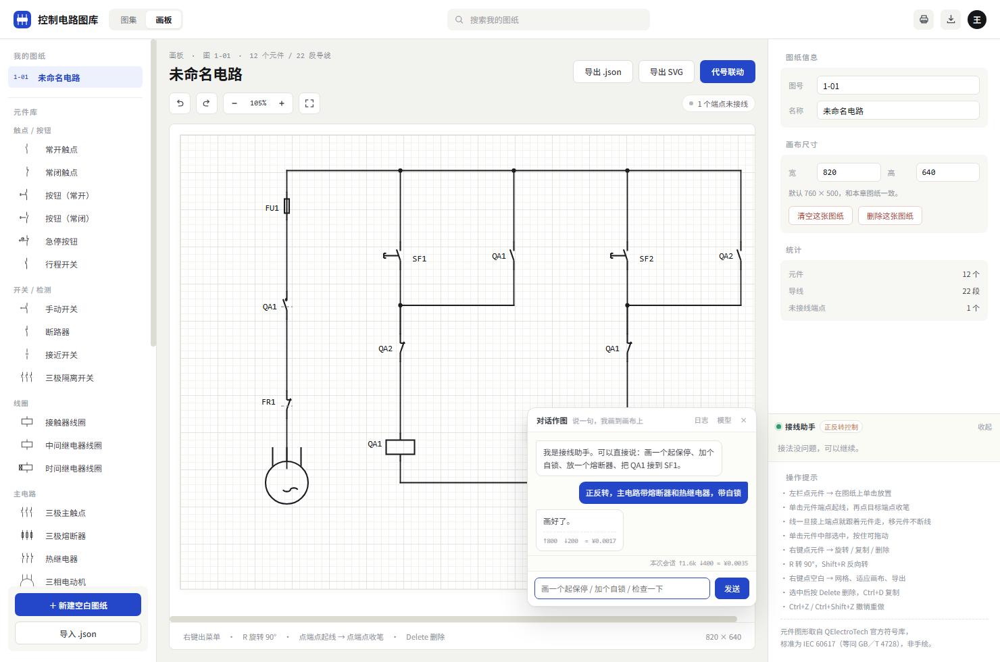
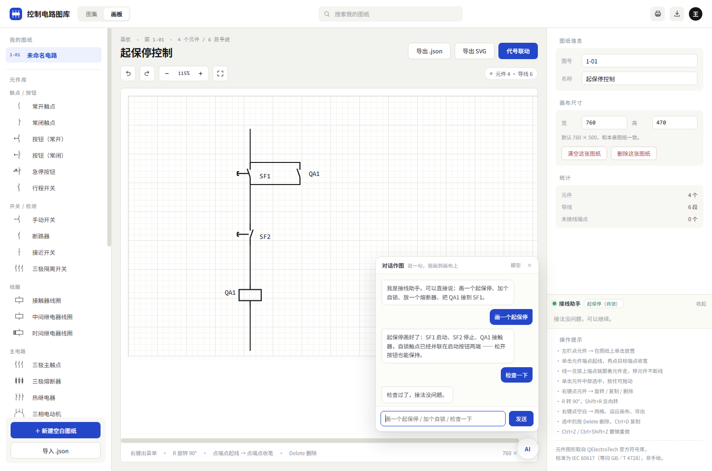
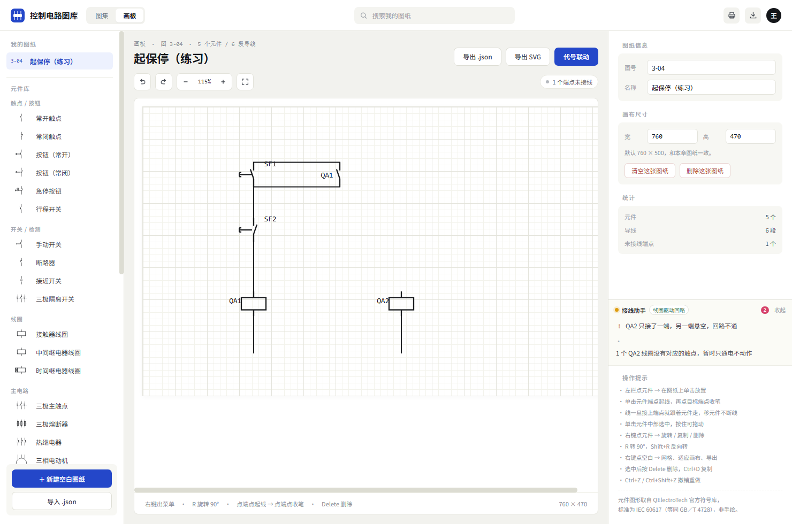
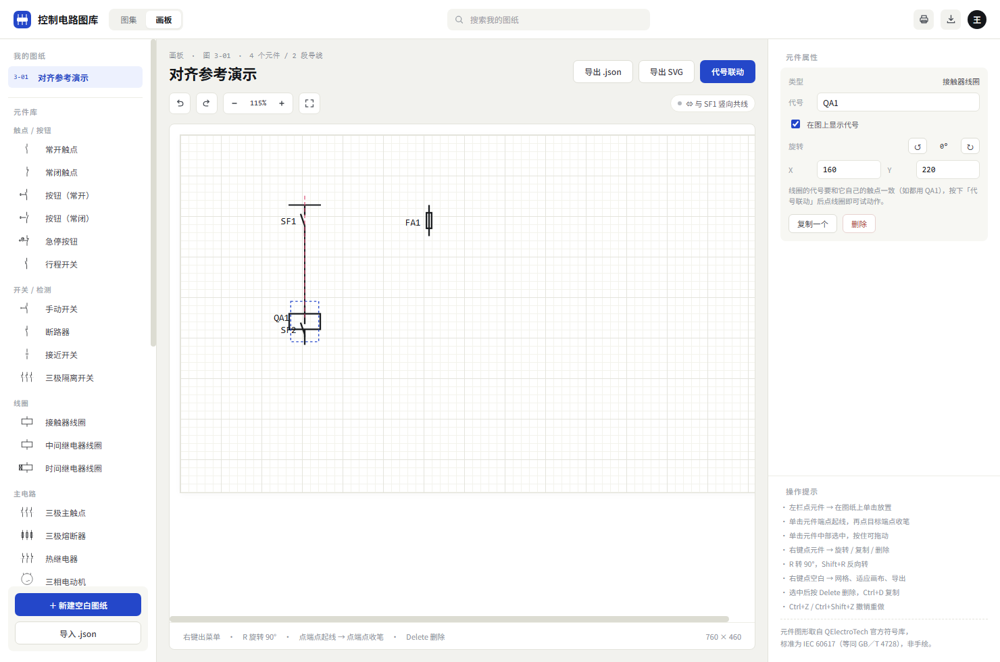

# PLC Atlas · 控制电路图库与可编辑画板


一个**零依赖、纯静态**的 PLC / 继电器接触器电气图纸工具：左边是图集，右边是画板；画板里内置接线助手和对话作图，可以一句话把中文意图画成电路图。

> 仅用于教学、绘图和交流，不用于现场接线或带电操作。

## 快速开始

1. 直接双击 `index.html`（推荐用 `file://` 打开）。
2. 顶部切换「图集 / 画板」；也可以打开 `index.html#draw` 直接进画板。
3. 画板右下角点 **AI** 打开对话窗口；右栏是接线助手。

不需要构建，不需要安装依赖。Node.js 只用于跑测试和重新生成符号库。

## 截图

<p align="center">
  
  
</p>
<p align="center">
  
  
</p>

## 能做什么

### 图集

- 5 张教学电路：点动、自锁、互锁正反转、双重互锁正反转、两地控制。
- 主电路 / 控制电路分区查看，动作演示按场景高亮。
- 导出 SVG；「照着这张画」会把图集电路转成可编辑图纸。

### 画板

- 元件库、拖拽、旋转、复制、撤销/重做、导入导出 JSON/SVG。
- 引脚吸附、正交走线、导线跟随元件、对齐参考线、网格吸附。
- 接线助手实时分析：悬空、短路、线头、线圈缺一端、触点无线圈、缺保护、电源端子/回路闭合。
- 多极元件、端子、接点、虚线/分区、文字标注。

### 对话作图

两级识别：

1. **内置规则**：毫秒级、离线可用，覆盖高频说法；
2. **模型**：OpenAI 兼容端点（默认 DeepSeek），支持流式、工具调用和 token 计量。

模型只表达电气意图（放什么、谁和谁同一根线），坐标、走线、吸附、绑定都由 `js/api.js` 算，所以模型再弱也不会画出歪线。

## 支持的指令

| 说法 | 谁处理 | 说明 |
|---|---|---|
| 画一个点动 / 起保停 / 自锁 / 互锁 / 正反转 | 内置 | 直接出图，不需要联网 |
| 正反转不带互锁 / 不带自锁 | 内置 | 不带互锁会提示相间短路风险 |
| 去除互锁 | 内置 | 删除互锁常闭触点并旁路接通 |
| 加个自锁 | 内置 | 给现有线圈补同名常开触点 |
| 放一个熔断器 / 加一个熔断器 | 内置 | 增量放置 |
| 把 QA1 接到 SF1 | 内置 | 两端自动走正交线 |
| 删掉 QA1 / no:QA1 | 内置 | 同名多件时要求 `类型:代号` |
| 检查一下 | 内置 | 返回电气问题列表；没有电源端子会说明“无法判断回路闭合” |
| 清空 / 重画一个正反转 | 内置 | `clear` 有快照回滚 |
| 正反转带主电路 | 模型 | 模型会调用 `draw_template` 的 `main:true`，复用图集 1-12 |
| 星三角 / 开放式描述 | 模型 | 走 `draw_plan` |

## AI 配置

画板 → 右下角 **AI** → **模型**：

- **接口**：OpenAI 兼容的 `/chat/completions`，默认 `https://api.deepseek.com/v1/chat/completions`
- **模型**：填你的端点实际支持的模型名（默认值在 `js/chat.js` 的 `DEFAULTS`）
- **Key**：只存本机 `localStorage`，不随导出文件分享
- **测试**：分层检查网络、CORS、HTTP 状态、key/模型名/余额

如果浏览器连不上外网：

1. 先双击 `网络诊断.html`，看是公网、DeepSeek 域名还是 API 单独不通；
2. 优先用 `file://` 打开 `index.html`，不要在 IDE/应用预览里跑；
3. 检查浏览器扩展、安全软件的 HTTPS 扫描、系统代理和 hosts。

## 模块

```
index.html                 两个应用：图集 / 画板
css/style.css
js/symgeo.js               标准符号几何（自动生成，勿手改）
js/symlib.js               几何 → SVG
js/symbols.js              图集的 Sheet 构建器
js/circuits.js             5 张教学电路 + 演示场景
js/editor-model.js         文档模型、元件表、引脚/绑定/渲染/存储
js/advisor.js              网表引擎 + 电气规则 + 意图识别
js/api.js                  给模型用的语义 API（place/wireNodes/drawPlan/drawTemplate…）
js/route.js                中文意图路由（纯函数，Node 可测）
js/prompt.js               人设卡与系统提示词（单一事实源）
js/templates.js            内置模板（点动/起保停/互锁/正反转/正反转+主电路）
js/chat.js                 对话作图：规则 + 模型工具循环 + 流式 + 日志
js/editor-ui.js            画板交互、属性面板、接线助手 UI
js/app.js                  图集交互
tools/qet-import.py        QElectroTech 符号抽取
tools/*-test.js            路由 / API / 提示词回归
docs/optimization-log.md   优化迭代日志
```

## 开发与测试

```bash
npm test                 # route + api + prompt 三套回归
npm run prompt           # 从 js/prompt.js 生成 提示词.md
npm run prompt:check     # 校验 提示词.md 没有过期
python tools/qet-import.py   # 重新生成符号库（需要网络）
```

CI 在 `.github/workflows/test.yml`：push 到 main / PR / 手动触发，Node 22，跑单元测试并检查提示词文档一致性。

## 符号来源与许可

- 符号几何来自 [QElectroTech](https://github.com/qelectrotech/qelectrotech-elements) 官方元件库。
- 标准为 **IEC 60617**（等同采用 **GB/T 4728**）。
- 符号库许可：**CC BY-SA 4.0**；再分发符号数据时请保留来源和许可声明。
- `js/symgeo.js` 由 `python tools/qet-import.py` 生成，不要手改。

代码部分尚未指定开源许可证；如需对外分发，请先补一个 LICENSE。

## 已知限制

- 纯前端、无后端；图纸存在浏览器 `localStorage`，清缓存会丢失，重要图纸请导出 JSON。
- AI 需要浏览器能访问你配置的 API；本地预览/沙箱常常禁外网。
- 极端跨列布局下，母线引出线可能穿过同列其他引脚；`draw_plan` 会回滚并报短路，不会静默画错。
- 主电路模板目前是固定版（熔断器、热继电器、电机、相序交换）；星三角尚未内置。
- 端子默认落在节点首个引脚上，复杂图上位置可能不够美观。
- 不做电气仿真、短路电流校验或安全认证。

## 路线图

- [x] 标准符号库、图集、可编辑画板
- [x] 网表分析、接线助手、对齐/导线跟随
- [x] 对话作图、流式、token 计量、运行日志
- [x] 意图路由 v2（否定/角色/复合指令）
- [x] `draw_plan` 原子回滚、`draw_template` 模板单一实现
- [x] 电源端子与回路闭合检查
- [x] 正反转 + 主电路模板
- [x] CI + 一键测试
- [ ] 星三角模板
- [ ] 错误定位/空状态/移动端优化
- [ ] 更多图集电路
